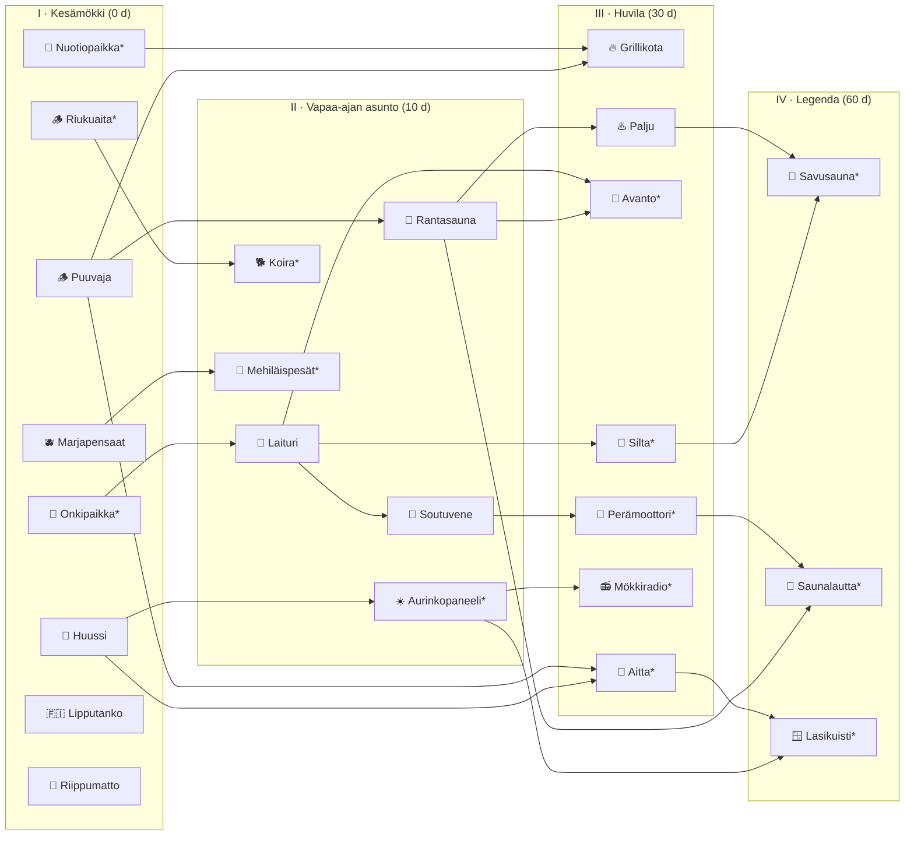

# Plan: Mökki Rakennuspuu (tech tree)

Status: **phases 1–4 implemented** on branch `feature/mokki-tech-tree` (2026-10-15). Phases 5–6 nodes are in the tree as "Tulossa" (coming soon). See `docs/DEPLOY-mokki-tech-tree.md`.

## Decisions (2026-10-15)
1. Parents must be **finished**, not just bought.
2. Rantasauna moves to era II (10 days played).
3. The dog breed is chosen at purchase, and breed and name can be changed later for free (in the dog sheet on the Mökki page).
4. Pranks are on by default, with the "Rauhallinen mökki" opt-out.
5. Rewards were raised from ~15 cr/day to **~20–25 cr/day** for a mökki built through phase 4, plus social bonuses. Every number is in `REWARDS` / `CATCHES` in `_shared/mokki.ts`.

## Goals
- Turn the flat Mökki build list into a Civilization-style tech tree.
  - Pieces unlock in order.
  - Big builds need the smaller builds that logically come before them.
- Bigger unlocks give something: daily chores, social actions on neighbors' islands, and perks.
- New small and big builds. These include a dog with 3 breeds (brown mini poodle, black Aussie with white face spots, brown Lagotto Romagnolo).
- Cheeky but harmless ways to mess with your neighbors.
- A tech-tree UI that feels like Civ: eras as columns, branches as lanes, glowing paths.

## Non-goals
- Real moderation or free-text chat. Every social message uses preset phrases.
- Anything that touches dice randomness or bet odds.
- Taking credits away from the player who gets pranked.

## Design rules
1. **Grandfathering.** Pieces you already own stay owned and keep working, even when the new tree says their parents are missing.
   - The tree is only checked when you **buy**, so existing rows need no migration.
   - A grandfathered piece counts as built when checking its own children.
   - Its missing parents can still be bought to fill in the gap. They are not granted for free.
   - In the UI these pieces get a small "🏃 Built ahead of its time" tag.
2. **Parents must be finished, not just bought.** You can't start the Palju while the Rantasauna is still scaffolding. This is the Civ feel and gives build days a purpose.
   - Today `canBuyPiece` only checks that the parent is owned.
3. **Eras gate by days played**, like Civ eras:
   - I Kesämökki: 0 days
   - II Vapaa-ajan asunto: 10 days
   - III Huvila: 30 days
   - IV Legenda: 60 days

   This keeps today's gates exactly: Laituri and Soutuvene 10, Grillikota and Palju 30.
   - The only tightening is Rantasauna. It moves from 0 to era II (10 days), because it now sits behind Puuvaja.
4. **One source of truth.** The tree, eras, actions, rewards and cooldowns all live in `supabase/functions/_shared/mokki.ts`.
   - The client renders from it. The edge functions enforce it.
   - The server never trusts prices, rewards or random rolls from the client.
5. **Economy.** A mökki built through phase 4 earns about 20–25 cr/day from chores, plus social bonuses (see §1.2).
   - The whole tree costs ~17,000 cr, so it pays back very slowly.
   - Every yield is a constant in the catalog, so tuning is a one-line change.
6. **Chores unlock after today's game** (the sauna is warm). The mökki stays a reward for playing, not a replacement for it.

---

## 1. The tree

24 nodes: the 10 existing pieces and 14 new ones, in 5 branches.


`*` = new node.

### 1.1 Nodes and what they give

Prices are in credits. Days are build days.

#### 🔥 Tuli & löyly (fire and sauna)

| Node | Era | Price / days | Requires | Gives |
|---|---|---|---|---|
| Puuvaja | I | 300 / 2 | — | The log pile grows with your streak (cosmetic). Root of the fire branch. |
| **Nuotiopaikka** (fire ring + log benches) | I | 100 / 1 | — | 🌭 **Makkaranpaisto** chore: +1/day. |
| Rantasauna | II | 700 / 3 | Puuvaja | ♨️ **Saunavuoro** chore: +2/day. Löyly you send makes a bigger puff. |
| Grillikota | III | 800 / 4 | Nuotiopaikka, Puuvaja | Makkaranpaisto becomes +3/day. 🌭 **Grillibileet**: visitors grab a makkara (+1 for them and +1 for you, max 5/day). |
| Palju | III | 900 / 4 | Rantasauna | ♨️ **Paljubileet**: visitors hop into your tub (+2 each, max 5/day). Their heads stay in the tub for the rest of the day. |
| **Savusauna** ★ | IV | 1800 / 5 | Palju, Silta | Stands on the luoto. 💨 **Savusaunan löyly**, once a week: a steam puff over *every* mökki on the lake, +2 to each neighbor. Saunavuoro becomes +4. |

#### 🌊 Järvi (lake)

| Node | Era | Price / days | Requires | Gives |
|---|---|---|---|---|
| **Onkipaikka** (shore rock, rod, bucket) | I | 100 / 1 | — | 🎣 **Onki** chore: tier 1 catch, 0–2 cr. Joke catches include a rubber boot and a Nokia 3310. |
| Laituri | II | 500 / 2 | Onkipaikka | Fishing tier 2 (1–3). |
| Soutuvene | II | 450 / 2 | Laituri | Fishing tier 3 (1–5, hauki chance). 🐟 **Kalalahja**: row today's catch to a neighbor (+2 for them). |
| **Silta** (bridge to the luoto) | III | 800 / 3 | Laituri | The little islet becomes buildable land (home of the Savusauna). |
| **Avanto** (ice hole + ladder at the end of the laituri) | III | 600 / 2 | Laituri, Rantasauna | 🧊 **Avantouinti** chore in Dec–Mar: +3/day. In summer it's a diving ladder. Badge **Jääkarhu** for 10 dips. |
| **Perämoottori** | III | 1200 / 3 | Soutuvene | Upgrades the rowing boat. 🌊 **Peräaalto** (cheeky): roar past a neighbor and swamp their soutuvene. |
| **Saunalautta** ★ | IV | 2500 / 5 | Perämoottori, Rantasauna | 🛟 **Lautta kylässä**, once a week: moor your sauna raft at a neighbor's island for a day. Anyone visiting that island can hop aboard (+2 for them and +2 for you, max 10). |

#### 🌿 Piha (yard)

| Node | Era | Price / days | Requires | Gives |
|---|---|---|---|---|
| Marjapensaat | I | 250 / 1 | — | 🫐 **Marjastus** chore in Jun–Sep: +1/day. 🫐 **Marjavarkaus** (cheeky): raid a neighbor's bushes. |
| **Mehiläispesät** | II | 500 / 2 | Marjapensaat | 🍯 Honey: +5 once a week. Bees pollinate, so Marjastus doubles. 🐝 **Mehiläisparvi** (cheeky): send a swarm to a neighbor's hammock. |

#### 🐕 Pihapiiri (yard life and dog)

| Node | Era | Price / days | Requires | Gives |
|---|---|---|---|---|
| Huussi | I | 150 / 1 | — | 🧻 **Vessapaperi-isku** (cheeky): toilet-paper a neighbor's birches. |
| **Riukuaita** (roundpole fence) | I | 150 / 1 | — | Cosmetic. Keeps the dog in. |
| **Koira** (dog + doghouse) | II | 700 / 2 | Riukuaita | Choose a breed and name it. 🐾 **Rapsuta** chore: +1/day. Guards against pranks. Each breed has its own trick (see §2). |
| **Aitta** (old guest storehouse) | III | 900 / 3 | Puuvaja, Huussi | 📖 **Vieraskirja**: visitors sign your guestbook with a preset line, shown on the notice board. |
| **Lasikuisti** ★ (glazed veranda, cabin upgrade) | IV | 2000 / 5 | Aitta, Aurinkopaneeli | 🏆 **Pokaalihylly**: your 3 rarest badges are on display to visitors. Warm lights at night. A "Mökkimestari" tag in the neighbors list. |

#### ☀️ Mökkielämä (leisure and tech)

| Node | Era | Price / days | Requires | Gives |
|---|---|---|---|---|
| Lipputanko | I | 200 / 1 | — | Flag picker (siniristi, Åland, Pride, pirate, Muumi), with automatic liputuspäivät. 🇸🇪 **Ruotsin lippu** (cheeky): hoist a Swedish flag on a neighbor's pole. |
| Riippumatto | I | 250 / 1 | — | 😴 **Päiväunet**: once every 7 days, a single missed day doesn't break your streak. |
| **Aurinkopaneeli** | II | 500 / 2 | Huussi | Sits on the huussi roof ("Finland's first solar huussi"). String lights on the porch at night. Starts the tech branch. |
| **Mökkiradio** | III | 600 / 2 | Aurinkopaneeli | A radio on the porch table. 📻 **Humppapommi** (cheeky): the neighbor's island blasts humppa (floating notes and a short jingle) the next time they open it. |

★ = era IV capstone ("wonder").

### 1.2 Daily yield check (as implemented)
| Chore | cr / day |
|---|---|
| 🌭 Makkaranpaisto | 2 (4 with Grillikota) |
| ♨️ Saunavuoro | 4 |
| 🎣 Onki | ~1.3 (Onkipaikka), ~2.8 (Laituri), ~5.3 (Soutuvene, hauki pays 10) |
| 🫐 Marjastus (Jun–Sep) | 3 |
| 🐾 Rapsuta | 2 |
| 🍄 Tryffelikoira (lagotto) | 1–4, doubled in autumn, 3% chance of a 30 cr truffle |
| 🐩 Makkaravaras (poodle) | 4, needs a neighbor with a Grillikota |
| 🛡️ Vahtikoira catch | +3 per foiled prank (aussie 50%, other breeds 20%) |

Social bonuses:

| Action | Visitor | Host |
|---|---|---|
| Palju | +3 | +2, max 5 guests a day |
| Grill | +2 | +1, max 5 guests a day |
| Kalalahja | +1 (sender) | +3 (receiver) |
| Cleaning up a prank | — | +2 |

---|---|
| Makkara | 3 |
| Saunavuoro | 4 |
| Onki | ~3 on average |
| Rapsuta | 1 |
| Dog trick | ~1.5 |
| Honey | ~0.7 |
| Marjastus (in season) | 2 |
| Avanto (in winter) | 3 |

That's about 13–17 cr/day before social bonuses. A new player with just Nuotiopaikka and Onkipaikka gets about 2 cr/day.

---

## 2. The dog 🐕

Pick the breed when you buy the Koira, and give it a name (max 16 characters).

| Breed | Look | Trick |
|---|---|---|
| **Ruskea pikkupuudeli** (brown mini poodle) | Small, chocolate brown, pom-poms on head, ears, tail and legs. Prances. | 🌭 **Makkaravaras**: sneaks to a neighbor's Grillikota and steals a makkara (+2 for you). The neighbor gets a note that "Pörrö ate your makkara". |
| **Musta aussi** (black Australian shepherd) | Black coat, white blaze, little white dots across the face, white chest, bobtail. | 🛡️ **Vahtikoira**: foils 50% of pranks (other breeds 20%). A foiled prank's loot is dragged back to your island (+2 for you). |
| **Ruskea lagotto romagnolo** | Curly brown coat (lumpy curl clusters), beard, round head. | 🍄 **Tryffelikoira**: daily dig for 1–3 cr. Mushrooms double the find in autumn. 2% chance of a tryffeli (+25). |

- **On the island:** wanders between waypoints and sits on the porch at night.
  - Swims off the laituri in summer and leaves paw prints in the snow.
  - Tap it to get a "Hau!" and hearts.
- **Visits:** it greets anyone visiting your island.
- **3D:** low-poly, built from the existing primitives in `scene/primitives.tsx`, in a new `scene/Dog.tsx`. All three breeds share one rig: body, head, 4 legs, tail, ears. Only the coat geometry and colors differ.

---

## 3. Neighbor interactions

### 3.1 Cheeky pranks
- 🧻 Vessapaperi-isku
- 🇸🇪 Ruotsin lippu
- 🫐 Marjavarkaus
- 🐝 Mehiläisparvi
- 🌊 Peräaalto
- 📻 Humppapommi
- 🌭 Makkaravaras (poodle)

**Rules:**
- **Who can do it:** the prankster needs the matching piece built. Some pranks also need a matching piece on the target: a flagpole for the flag, bushes for berries, a boat to swamp, a hammock for the swarm, a grillikota for the makkara.
- **How often:** one of each prank per target per day. Only one of each kind can be active on an island at a time ("Aino already TP'd this mökki, look!").
- **Visible to everyone:** visitors see it too, which is the fun.
- **How it ends:** it lasts until the owner cleans it up (tap it) or for 24 h. Cleaning up pays a +1 **siivouspalkkio**, so a prank never costs the target anything.
- **Dog defense:** the target's dog may foil it. The server rolls the dice.
- **Inbox:** the porch **mailbox** finally gets used. `porch.hasMail` is already wired but always false. It lists what happened since your last visit.
- **Opting out:** Customization gets a **"Rauhallinen mökki"** switch (default off, so pranks are allowed). Turning it on blocks pranks against you, and you can't prank anyone either.
- **Test users** are excluded, same as the neighbors list.

### 3.2 Friendly interactions
- Löyly (already exists)
- 🐟 Kalalahja
- ♨️ Paljubileet
- 🌭 Grillibileet
- 📖 Vieraskirja
- 💨 Savusaunan löyly
- 🛟 Lautta kylässä

These are what make visiting worth it: the visitor usually earns a little too.

---

## 4. Tech tree UI

The full-screen **Rakennuspuu** opens from the bottom panel.

```
┌──────────────────────────────────────────────────────────────┐
│ ← 🌳 Rakennuspuu                  9/24 built     🪙 1 240    │
│ [I Kesämökki ✓] [II Vapaa-ajan ✓] [III Huvila 🔒 18/30 d] [IV]│  ← era pills, tap to jump
├────────┬─────────────┬─────────────┬─────────────┬───────────┤
│🔥 Tuli │ ●Puuvaja ━━━━━▶ ●Sauna ━━━━━━▶ ◌Palju ┄┄┄┄┄▶ ▫Savusauna│
│        │ ●Nuotio ━━━━━━━━━━━━━━━━━━━━━▶ ◌Grillikota            │
│🌊 Järvi│ ●Onki ━━━━━━━▶ ◐Laituri 2d ┄┄▶ ▫Silta ┄┄┄┄┄┄┄┄┄┄┄┄┘    │
│  …     │                                                       │
└──────────────────────────────────────────────────────────────┘
 ● built  ◐ building (progress ring)  ◌ available (pulsing)  ▫ locked
```

**Layout**
- Each node has a fixed `{ era, lane, row }` in the catalog. Hand-placed so it stays crisp, no auto-layout.
- Columns are eras. Rows are branches, and each branch header with its emoji stays pinned on the left.
- Swipe horizontally. Era pills scroll to that column.
- On open, the tree auto-scrolls to the frontier: the first available node.

**Edges**
- SVG bezier curves.
- Solid and colored when both ends are built.
- An animated dashed "glow" when the child is buyable.
- Dim grey when locked.

**Node card**
- Shows emoji, name and price.
- **Built:** filled in the branch color with a ✓.
- **Building:** amber, with a progress ring and days left.
- **Available:** pulsing outline.
- **Locked:** greyscale and 🔒.
- **Grandfathered:** gets the 🏃 tag.

**Detail sheet** (tap a node)
- Description and build days.
- **Gives:** chips for each benefit.
- **Requires** / **Leads to:** chips; tap one to jump to that node.
- A Build button.
- For locked nodes, the whole prerequisite chain lights up and the sheet shows **"Path: 3 builds · 1 450 cr"**, the Civ "research path" feature.
- The dog's purchase flow adds a breed picker (3 cards with mini 3D previews) and a name field.

**Unlock moment**
- When a node finishes, the tree pops the node and runs light along its outgoing edges.
- The existing drop-in and hammer animation on the island stays.

**Bottom panel on your own island** (replaces today's list)
- A summary row: "🌳 Rakennuspuu · 9/24 · 2 available".
- An **Askareet** tray of today's chore chips (🎣 🌭 🫐 🐾 …).
  - Each chip shows done/not done and pops the credits when tapped.
  - Chores can also be triggered by tapping the 3D object itself, using the existing `Interactive` wrapper.

**Bottom bar on a neighbor's island**
- Löyly.
- Friendly actions available on that island.
- A 😈 button that opens the prank picker. Unavailable pranks are greyed out with the reason ("They have no flagpole").

---

## 5. Data and backend

### 5.1 Shared module (`_shared/mokki.ts`)
- `MokkiPieceDef` gains:
  - `era`
  - `lane`
  - `row`
  - `gives: BenefitId[]`
  - optional `variants`: dog breeds
- `canBuyPiece(id, ownedRecords, gamesPlayed)` checks, in order:
  1. Every parent is owned **and complete**.
  2. The era's day gate.
  3. The variant is valid.
  4. Not already owned.
- New `MOKKI_ACTIONS` catalog. Each action has:
  - `id` and `kind`: `chore`, `social` or `prank`
  - `requiresPiece` and `targetRequiresPiece`
  - `cooldown`: `daily` or `weekly`
  - `seasons`
  - `needsPlayedToday`
  - reward table and ledger reason
- New `canDoAction(...)`, a pure function used by both client and server.
- New `bridgedStreak(dates, napsAllowedFrom)` for Päiväunet.
  - Stateless: a single one-day gap is bridged at most once in any rolling 7 days, and only after the hammock was bought.
  - Used by `check-achievements` and `useGameRecords`, so the sauna line and streak badges agree.

### 5.2 Migration
No changes to existing rows, so grandfathering is free.
- `mokki_pieces`:
  - Add `variant TEXT` (dog breed; flag choice).
  - Add `nickname TEXT CHECK (char_length(nickname) <= 16)`.
- `mokki_actions(user_id, action_id, target_user_id, action_date, reward, meta jsonb, created_at)`.
  - Unique on `(user_id, action_id, coalesce(target_user_id, user_id), action_date)` for daily cooldowns.
  - Weekly cooldowns are checked in the function.
- `mokki_effects(id, target_user_id, from_user_id, kind, outcome ('landed'|'foiled'), created_at, expires_at, cleared_at, seen_at)`.
  - Holds active pranks and visiting rafts. Readable by any signed-in player, because islands are public.
- `mokki_guestbook(owner_id, visitor_id, phrase_id, signed_date)`. Unique per visitor per day.
- `user_settings.peaceful_mokki BOOLEAN DEFAULT false`.
- RPC `get_mokki_island(p_user_id)`. It extends what `get_mokki_owner` returns with:
  - active effects
  - today's palju guests
  - the last 10 guestbook lines
  - the dog's breed and name
- All writes go through the service role. Every credit change also writes a `credit_ledger` row.

### 5.3 Edge functions
- `buy-mokki-piece`:
  - Pass the full owned records (needed for the "parent is finished" check).
  - Accept and validate `variant` and `nickname` for the dog.
- **New `mokki-action`** takes `{ actionId, targetUserId?, payload? }` and:
  - checks auth
  - checks the rules via `canDoAction`
  - makes the server-side random rolls (catch, dog guard, truffle)
  - inserts the action and effect rows
  - credits the player via `increment_user_credits` and writes the ledger row
  - returns the outcome so the client can animate it
- Cleaning up a prank, signing the guestbook and choosing a flag are all actions in the same function. One endpoint, one rule set.

---

## 6. 3D placement

The main island is nearly full, so the big new builds go on the water and on the luoto.

| Piece | Where |
|---|---|
| Onkipaikka | A shore rock on the south-east |
| Nuotiopaikka | Between the mailbox and Grillikota |
| Riukuaita | Along the back (north-west) edge |
| Koira + koppi | Doghouse by the fence; the dog roams |
| Mehiläispesät | Behind Marjapensaat |
| Aurinkopaneeli | On the Huussi roof |
| Mökkiradio | On the porch table |
| Avanto | At the end of the Laituri, as an ice hole or a summer ladder |
| Perämoottori | Swaps the Soutuvene model |
| Silta | Bridge to the luoto at `[-1.7, 0, 6.5]`; the luoto grows once built |
| Savusauna | On the luoto |
| Saunalautta | Floats in the bay, or at a neighbor's island while visiting |
| Aitta | Replaces the west pine at `[-4.45, G, 0.85]` |
| Lasikuisti | Replaces the porch railing with a glazed veranda |

Pranks are overlays in a new `scene/Effects.tsx`:
- 🧻 TP streamers on the birches
- 🇸🇪 flag on the pole
- 🐝 swarm over the hammock
- 🌊 a waterlogged boat sitting low in the water
- 📻 floating notes

---

## 7. Phases

| # | Scope | Rough size |
|---|---|---|
| 1 | **Tree foundation.**<br>• Catalog restructure, era and parent rules, unit tests (DAG check, grandfathering, building parent blocks the child).<br>• `buy-mokki-piece` update.<br>• Full tech-tree UI.<br>• The 3 cheap roots: Nuotiopaikka, Onkipaikka, Riukuaita.<br>• The other new nodes show as **"Tulossa"** silhouettes so the whole tree is visible from day one. | L |
| 2 | **Chores engine.**<br>• `mokki_actions`, `mokki-action` function, Askareet tray, mailbox inbox.<br>• Chores: Onki, Makkaranpaisto, Marjastus, Saunavuoro.<br>• Päiväunet streak bridge (client and `check-achievements`).<br>• Flag picker. | L |
| 3 | **Koira.**<br>• 3 breed models, roaming, naming, breed picker, Rapsuta, Tryffelikoira. | M–L |
| 4 | **Neighbors.**<br>• `mokki_effects`, prank picker, effect overlays, cleanup, dog guard (Vahtikoira, Makkaravaras), "Rauhallinen mökki".<br>• Kalalahja, Paljubileet, Grillibileet. | L |
| 5 | **Era II–III builds.**<br>• Mehiläispesät, Aurinkopaneeli, Mökkiradio, Avanto, Silta + luoto, Aitta + Vieraskirja, Perämoottori. | L |
| 6 | **Era IV capstones.**<br>• Savusauna, Saunalautta, Lasikuisti.<br>• Badges: Jääkarhu, Vahtikoira, Pihapiirin kauhu (10 pranks landed), Rakennusmestari (whole tree). | M–L |

Each phase can ship on its own.
- Phase 1 alone already gives the tree.
- Avanto (winter) is worth having by December.

## 8. Rollout notes
- Apply migrations in the **Lovable SQL editor** (project `sbnojaeuhjufjbljokgl`). The Supabase MCP points at a different project.
- After pushing, check for Lovable bot commits that revert from a stale copy, and restore forward if needed.
- Extend the dev-only `/mokki-preview` route with:
  - `?view=tree`
  - `?dog=poodle|aussie|lagotto`
  - `?effects=all`

  These are for screenshots and visual checks.

## 9. Open questions
1. **Parents must be finished, not just bought.** Proposed: yes. OK?
2. **Rantasauna moves to era II** (10 days played). Players with fewer days who haven't bought it yet have to wait. OK?
3. **Dog breed.** Proposed: chosen once at purchase, but changeable later in Customization for free. Alternative: fixed, with a later "Toinen koira" node for a second dog.
4. **Pranks.** On by default, with a "Rauhallinen mökki" opt-out. OK?
5. **Economy.** Is ~15 cr/day for a fully built mökki the right ceiling?
